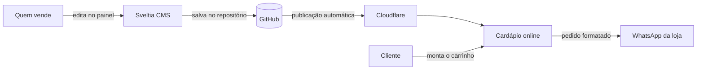

# Cardápio Digital — Astro + Sveltia CMS

**Um cardápio online com pedido pelo WhatsApp, feito para pequenos negócios de
alimentação que querem vender pela internet sem pagar mensalidade de plataforma.**

Docerias, confeitarias, salgaderias, marmitarias e lanchonetes que vendem por
encomenda costumam receber pedidos em mensagens soltas: o cliente pergunta o
preço, pede foto, esquece um item, e o vendedor monta tudo à mão. Este cardápio
organiza esse processo. O cliente vê os produtos com foto e preço, monta o
carrinho e envia um pedido completo e já formatado pelo WhatsApp. Do outro lado,
quem vende atualiza produtos, preços e promoções sozinho, por um painel simples
no navegador.

---

## Por que este cardápio

- **Sem mensalidade.** O site é estático e roda no plano gratuito da Cloudflare.
  Não há assinatura de plataforma nem taxa por pedido.
- **O negócio é dono do próprio site.** O código e o conteúdo ficam no GitHub do
  cliente, e não presos a um serviço de terceiros.
- **Autonomia no dia a dia.** Trocar um preço, marcar um produto como esgotado ou
  criar um cupom é feito pelo painel, sem depender de programador.
- **Pedido que chega pronto.** A mensagem no WhatsApp já vem com itens,
  quantidades, totais, desconto, forma de entrega e dados do cliente.
- **Rápido e leve.** Páginas estáticas carregam bem mesmo em celular com conexão fraca.

## Funcionalidades

### Para o cliente
- Cardápio em grade com filtro por categoria, sem recarregar a página.
- Página de cada produto, com foto ampliável e seletor de quantidade.
- Carrinho salvo no navegador, com fluxo carrinho → checkout → confirmação.
- Cupons de desconto em percentual ou valor fixo.
- Escolha entre entrega e retirada, com taxa de entrega calculada no total.
- Envio do pedido ao WhatsApp da loja, com número de pedido.
- Tema claro e escuro, que segue a preferência do aparelho.

### Para quem vende
- Painel visual em `/admin` para cadastrar produtos, categorias e fotos.
- Produtos podem ser marcados como esgotados ou escondidos do site sem serem apagados.
- Cupons com validade por data ou até um horário exato, e uso único por cliente.
- Entrega e retirada ativadas separadamente, com taxa fixa ou "a combinar".
- Aviso opcional de **próxima fornada** no topo do cardápio, com data e hora ou
  um aviso de "em preparação".

### Confiabilidade
- Mais de 140 testes automatizados cobrindo carrinho, cupons, mensagem do pedido,
  regras do painel e renderização das páginas.
- Fotos ausentes ou quebradas são substituídas por um placeholder, e o site nunca
  deixa de ser publicado por causa de uma imagem.
- Preview de link com imagem e descrição (Open Graph) ao compartilhar no WhatsApp
  e nas redes sociais.
- Página 404 e estados vazios tratados com a identidade visual da loja.
- Leve: o site inteiro carrega menos de 40 KB de JavaScript e CSS.

## Como funciona



O conteúdo vive no próprio repositório, em arquivos Markdown e JSON. Cada
alteração feita no painel é salva como um commit, e cada commit publica uma nova
versão do site em cerca de um minuto. Não há banco de dados para manter nem
servidor para atualizar.

## Tecnologias

| Camada | Tecnologia |
|---|---|
| Site | [Astro](https://astro.build), gerado como site estático |
| Conteúdo | Content Collections com validação de schema |
| Painel | [Sveltia CMS](https://github.com/sveltia/sveltia-cms), baseado em Git |
| Login do painel | [`sveltia-cms-auth`](https://github.com/sveltia/sveltia-cms-auth) em um Cloudflare Worker (OAuth do GitHub) |
| Hospedagem | Cloudflare Workers com static assets |
| Testes | [Vitest](https://vitest.dev) e Container API do Astro |

## Rodando localmente

```bash
npm install
npm run dev       # http://localhost:4321
npm test          # testes automatizados
npm run build     # gera o site em ./dist
npm run preview   # pré-visualiza o site gerado
```

## Adaptando para um negócio

O projeto vem pronto com uma loja de demonstração, a **Doceria Exemplo**, com
produtos, categorias e um cupom. A identidade de cada loja fica concentrada em
poucos arquivos:

| Arquivo | O que define |
|---|---|
| `src/config/site.ts` | Nome, slogan, descrição, WhatsApp, Instagram, logo, prefixo do pedido e créditos |
| `src/styles/theme.css` | Cores, fontes, bordas e sombras, nos modos claro e escuro |
| `src/config/theme.ts` | Fontes carregadas e cor da barra do navegador |
| `astro.config.mjs` | Endereço do site |
| `public/admin/config.yml` | Repositório e login do painel |
| `wrangler.jsonc` | Nome do projeto na Cloudflare |
| `src/content/` | Produtos, categorias, cupons e configurações iniciais |
| `public/` | Logo, ícone e imagem de compartilhamento |

Toda a aparência é definida por tokens de tema: trocar a identidade visual de
uma loja não exige mexer nos componentes.

O passo a passo completo está em [README-TEMPLATE.md](README-TEMPLATE.md).

## Publicação

1. Crie um repositório para a loja a partir deste projeto.
2. Na Cloudflare, conecte o repositório em *Workers & Pages*, com `npm run build`
   como comando de build e `npx wrangler deploy` como comando de deploy.
3. Publique o worker de login do painel e configure `GITHUB_CLIENT_ID`,
   `GITHUB_CLIENT_SECRET` (como secret) e `ALLOWED_DOMAINS`.
4. Dê acesso ao painel por uma conta GitHub dedicada da loja, adicionada como
   colaboradora apenas neste repositório.

Nenhuma credencial fica no código: tokens e segredos ficam guardados na Cloudflare,
e a conta usada no painel só tem acesso ao repositório da própria loja.

## Documentação

| Documento | Conteúdo |
|---|---|
| [Cupons, pedidos e entrega](docs/CUPONS-E-PEDIDOS.md) | Regras de cupom, número do pedido, entrega, retirada e aviso de fornada |
| [Páginas institucionais](docs/PAGINAS-INSTITUCIONAIS.md) | Como editar as páginas Sobre, Contato e Desenvolvedor |
| [Logo e compartilhamento](docs/LOGO.md) | Como trocar o logo, o ícone e a imagem de preview do link |
| [Testes](docs/TESTES.md) | O que os testes cobrem e como rodá-los |
| [Histórico de correções](docs/BUGS-E-CORRECOES.md) | Problemas encontrados em uso e como foram resolvidos |
| [Changelog](CHANGELOG.md) | Novidades de cada versão |

## Autor

Desenvolvido por **Lukas** · [GitHub](https://github.com/lukasuvinha)

Quer um cardápio como este para o seu negócio, com a sua marca e os seus
produtos? Entre em contato.
