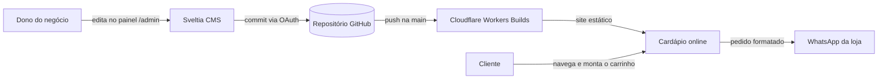

# Cardápio Digital — Astro + Sveltia CMS

Template de cardápio digital para pequenos negócios de alimentação (docerias,
confeitarias, salgaderias, marmitarias). O cliente final navega pelos produtos,
monta o carrinho e envia o pedido pronto pelo **WhatsApp**. Quem vende atualiza
produtos, preços, cupons e avisos sozinho, por um **painel visual**, sem tocar
em código.

O site é **100% estático**: não tem servidor, banco de dados nem mensalidade de
plataforma. Roda no plano gratuito da Cloudflare e o código fica no GitHub do
próprio dono do negócio.

> Este template nasceu de um cardápio real em produção. As funcionalidades e as
> correções vieram do uso no dia a dia, não de suposição.

---

## Funcionalidades

**Para quem compra**
- Cardápio em grade com filtro por categoria, sem recarregar a página.
- Página de detalhe por produto, com foto ampliável e seletor de quantidade.
- Carrinho salvo no navegador, com fluxo carrinho → checkout → confirmação.
- Cupons de desconto (percentual ou valor fixo), com validade por data ou hora exata.
- Escolha entre entrega e retirada, com taxa de entrega somada automaticamente.
- Pedido enviado ao WhatsApp da loja com itens, totais, dados do cliente e forma
  de pagamento já formatados, além de um número de pedido.
- Tema claro e escuro, que respeita a preferência do sistema.

**Para quem vende (pelo painel `/admin`)**
- Cadastro de produtos, categorias e fotos.
- Marcar produto como esgotado ou escondê-lo do site sem apagar.
- Criar e encerrar cupons.
- Ligar ou desligar entrega e retirada e definir a taxa de entrega.
- Banner opcional **"Próxima fornada"**, com data e hora ou aviso de "em preparação".

**Qualidade**
- Mais de 130 testes automatizados (Vitest), incluindo guardas contra
  regressões que já aconteceram em produção com o CMS.
- Fotos quebradas ou ausentes caem num placeholder, e o build nunca falha por causa de imagem.
- Meta tags Open Graph para o link ficar com preview bonito no WhatsApp e nas redes.
- Página 404 própria e estados vazios tratados ("cardápio em atualização").

## Como funciona



Cada edição feita no painel vira um commit no repositório, e cada commit na
`main` dispara um novo deploy. Não existe banco de dados: o próprio repositório
é a fonte do conteúdo.

## Stack

| Camada | Tecnologia |
|---|---|
| Site | [Astro](https://astro.build) com saída estática |
| Conteúdo | Content Collections (Markdown + JSON) com schemas validados |
| Painel | [Sveltia CMS](https://github.com/sveltia/sveltia-cms) (Git-based) |
| Login do painel | Worker [`sveltia-cms-auth`](https://github.com/sveltia/sveltia-cms-auth) na Cloudflare (OAuth do GitHub) |
| Hospedagem | Cloudflare Workers com static assets |
| Testes | [Vitest](https://vitest.dev) + Container API do Astro |

## Início rápido

```bash
npm install
npm run dev       # http://localhost:4321
npm test          # suíte de testes
npm run build     # gera o site em ./dist
npm run preview   # pré-visualiza o build
```

## Personalizando para um novo negócio

Toda a identidade do cliente fica concentrada em poucos arquivos:

| Arquivo | O que trocar |
|---|---|
| `src/config/site.ts` | Nome, slogan, WhatsApp, Instagram e créditos do desenvolvedor |
| `astro.config.mjs` | URL de produção (`SITE_URL`) |
| `public/admin/config.yml` | Repositório e URL do worker de login do painel |
| `wrangler.jsonc` | Nome do projeto na Cloudflare |
| `src/content/` | Produtos, categorias e configurações de exemplo |
| `public/` | Logo e imagem de compartilhamento |

O passo a passo completo está em [README-TEMPLATE.md](README-TEMPLATE.md).

## Publicação

1. **Repositório:** crie um repositório para o cliente a partir deste template.
2. **Site:** na Cloudflare, conecte o repositório em *Workers & Pages* usando
   `npm run build` como comando de build e `npx wrangler deploy` como comando de deploy.
3. **Login do painel:** publique o worker `sveltia-cms-auth` e configure
   `GITHUB_CLIENT_ID`, `GITHUB_CLIENT_SECRET` (como secret) e `ALLOWED_DOMAINS`.
4. **Acesso do cliente:** recomenda-se uma conta GitHub dedicada ao dono do
   negócio, adicionada como colaboradora **só** neste repositório. Se a
   credencial vazar, o estrago fica contido.

Nenhum token ou segredo fica no repositório. As credenciais ficam guardadas na Cloudflare.

## Documentação

| Documento | Conteúdo |
|---|---|
| [Cupons, pedidos e entrega](docs/CUPONS-E-PEDIDOS.md) | Regras de cupom, numeração de pedido, entrega/retirada e banner de fornada |
| [Páginas institucionais](docs/PAGINAS-INSTITUCIONAIS.md) | Como editar Sobre, Contato e Desenvolvedor |
| [Testes](docs/TESTES.md) | O que a suíte cobre e o que ainda está em aberto |
| [Bugs e correções](docs/BUGS-E-CORRECOES.md) | Incidentes reais com o CMS e como foram blindados |
| [Changelog](CHANGELOG.md) | Novidades de cada versão |

## Convenções

- Funcionalidade desativada é comentada no lugar, com a indicação de como reativar, e não apagada.
- Componentes reutilizáveis em vez de código específico de página.
- Todo ajuste visual precisa funcionar nos temas claro e escuro.
- Nenhuma credencial no código, com scan de segredos antes de cada PR.
- Commits, PRs e documentação em português.

## Roadmap

- [ ] Tema configurável (cores e fontes por cliente em um único arquivo)
- [ ] Visual base neutro, com o tema de confeitaria como uma das opções
- [ ] Remover as referências restantes ao projeto de origem em textos e testes
- [ ] Badge de CI com a suíte de testes no GitHub Actions

## Autor

Desenvolvido por **Lukas** · [GitHub](https://github.com/lukasuvinha)

Precisa de um cardápio digital para o seu negócio? Entre em contato pelo GitHub.
